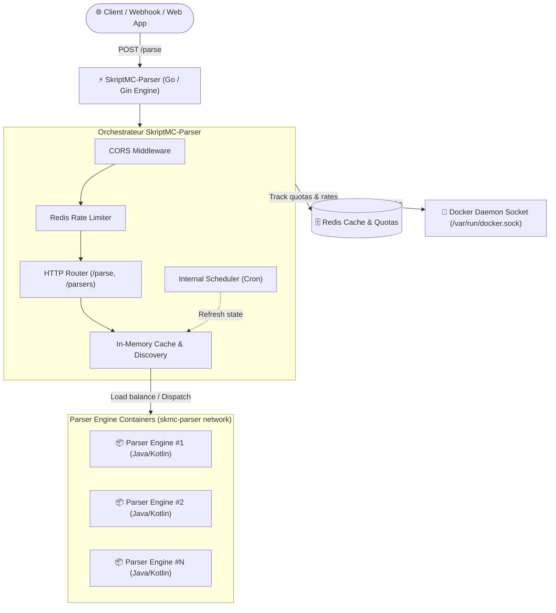

# SkriptMC-Parser

<div align="center">

[](https://golang.org)
[](https://www.docker.com)
[](https://opensource.org/licenses/MIT)
[]()

**High-performance distributed orchestrator and gateway for remote Skript syntax validation.**

[Fonctionnalités](#-fonctionnalités-clés) •
[Architecture](#-architecture-technique) •
[API Reference](#-spécification-api) •
[Installation & Déploiement](#-installation--démarrage) •
[Configuration](#-configuration)

</div>

---

## 🎯 Problématique & Vision

Dans l'écosystème Minecraft, le langage **Skript** permet d'automatiser des mécaniques de jeu complexes sans coder de plugins Java complets. Cependant, tester et valider la syntaxe d'un script nécessitait jusqu'alors de démarrer une instance de serveur complet (Paper/Spigot), un processus lourd, lent et consommateur de ressources.

**SkriptMC-Parser** a été conçu pour résoudre ce goulet d'étranglement. Il agit comme un **reverse-proxy et orchestrateur de conteneurs**, capable de recevoir du code Skript via une API REST sécurisée et de distribuer l'exécution sur un pool de conteneurs légers d'analyse syntaxique (*parser engines*) isolés et éphémères.

---

## ⚡ Fonctionnalités clés

- **Dynamic Container Discovery & Routing** : Découverte automatique des moteurs de parsing actifs via les labels de l'API Docker (`skriptmc.parser.engine-version`).
- **Load Balancing intelligent** : Distribution uniforme des requêtes d'analyse sur l'ensemble des conteneurs sains disponibles.
- **Distributed Rate Limiting** : Protection contre les attaques DoS et l'abus de ressources via un middleware Redis distribué (`ulule/limiter`).
- **12-Factor Configuration** : Gestion unifiée de la configuration par fichier YAML et surcharge complète par variables d'environnement (`SKMC_*`).
- **Tâches planifiées & Auto-guérison** : Planification de routines crontab internes pour rafraîchir le cache des nœuds et surveiller l'état du cluster de conteneurs.
- **Docker Multi-Stage Build** : Image de production ultra-légère basée sur Alpine Linux pour des temps de déploiement minimaux.

---

## 🏗 Architecture Technique



### Justification de la Stack

- **Go (Golang)** : Choisi pour sa faible empreinte mémoire, sa concurrence native ultra-efficace (goroutines) et la puissance de son client Docker officiel (`github.com/docker/docker/client`).
- **Gin Web Framework** : Routeur HTTP rapide et minimaliste à très faible allocation mémoire.
- **Redis (v8 client)** : Stockage volatile et ultra-rapide utilisé pour partager l'état du rate limiter à travers d'éventuelles répliques du coordinateur.
- **Docker Engine API** : Communication directe via socket UNIX (`/var/run/docker.sock`) évitant toute couche middleware tierce superflue pour la gestion de l'infrastructure de workers.

---

## 📂 Arborescence du Projet

```text
skmc-parser/
├── cache/                  # Gestionnaire de cache local pour les conteneurs découverts
│   └── main.go             # Rafraîchissement périodique et inspection des labels Docker
├── config/                 # Initialisation et injection de la configuration (Viper)
│   └── main.go             # Binding automatique des variables d'environnement SKMC_*
├── docker/                 # Client officiel Docker Engine
│   └── main.go             # Connexion Unix socket (/var/run/docker.sock) ou named pipe Windows
├── http/                   # Couche transport HTTP (Gin)
│   ├── handlers/           # Contrôleurs HTTP (/parse, /parsers)
│   ├── middlewares/        # Middlewares applicatifs (CORS sécurisé, Rate Limiter)
│   └── main.go             # Enregistrement des routes et écoute serveur
├── redis/                  # Client Redis distribué pour le rate limiting
│   └── main.go             # Connexion et healthcheck du cluster Redis
├── structures/             # Modèles de données typés et contexte global partagé
├── tasks/                  # Ordonnanceur de tâches de fond (crontab interne)
│   ├── scheduled/          # Tâches périodiques (santé et synchronisation des parsers)
│   ├── standalone/         # Tâches déclenchées à la demande
│   └── main.go             # Registre et démarrage du scheduler
├── config.yaml             # Configuration par défaut
├── Dockerfile              # Build multi-stage optimisé pour production
├── go.mod                  # Définition des modules et versions Go
└── main.go                 # Point d'entrée de l'application
```

---

## 📡 Spécification API

### 1. `GET /parsers`
Retourne la liste des conteneurs de parsing actifs et leur état de santé.

**Exemple de Réponse :**
```json
{
  "lastUpdated": "2026-10-30T14:00:00Z",
  "parsers": [
    {
      "name": "/skmc-engine-1",
      "version": "1.0.0",
      "state": "running",
      "status": "Up 2 hours"
    }
  ]
}
```

---

### 2. `POST /parse`
Envoie un script au routeur pour analyse syntaxique. La requête est acheminée vers un conteneur sain au hasard.

**En-têtes de Requête :**
```http
Content-Type: text/plain
```

**Corps de la Requête :**
```text
command /teleport <player>:
    permission: op
    trigger:
        teleport player to arg-1
        send "Teleported!" to player
```

**Exemple de Réponse :**
```json
{
  "success": true,
  "errors": [],
  "warnings": []
}
```

---

## 🚀 Installation & Démarrage

### Prérequis

- **Docker & Docker Compose** (ou accès au socket `/var/run/docker.sock`)
- **Instance Redis** accessible (locale ou distante)
- **Go 1.25+** (pour l'exécution hors conteneur)

### Déploiement via Docker (Recommandé)

```bash
docker run -d \
  --name skmc-parser \
  --restart unless-stopped \
  --publish 8000:8000 \
  -v /var/run/docker.sock:/var/run/docker.sock \
  --env SKMC_REDIS_ADDRESS="redis.internal:6379" \
  --env SKMC_REDIS_PASSWORD="your-strong-password" \
  ghcr.io/romitou/skmc-parser:latest
```

### Développement Local

1. **Cloner le dépôt** :
   ```bash
   git clone git@github.com:Romitou/SkriptMC-Parser.git
   cd SkriptMC-Parser
   ```

2. **Créer une configuration locale** :
   ```bash
   cp config.yaml config.local.yaml
   # Ajustez vos paramètres locaux dans config.local.yaml
   ```

3. **Compiler et exécuter** :
   ```bash
   go mod download
   go run main.go
   ```

---

## ⚙️ Configuration

Les variables de configuration peuvent être définies dans `config.yaml`, surchargées par un fichier `config.local.yaml` (ignoré par Git) ou injectées dynamiquement via des variables d'environnement avec le préfixe `SKMC_` :

| Propriété YAML | Variable d'environnement | Valeur par défaut | Description |
| :--- | :--- | :--- | :--- |
| `http.listen` | `SKMC_HTTP_LISTEN` | `0.0.0.0` | Adresse d'écoute HTTP |
| `http.port` | `SKMC_HTTP_PORT` | `8000` | Port d'écoute du serveur web |
| `rateLimiter.limit` | `SKMC_RATELIMITER_LIMIT` | `1000-H` | Quota de requêtes par IP (ex: 1000/heure) |
| `rateLimiter.prefix` | `SKMC_RATELIMITER_PREFIX` | `limiter_skmcparser` | Préfixe des clés dans Redis |
| `redis.address` | `SKMC_REDIS_ADDRESS` | `127.0.0.1:6379` | Hôte et port de l'instance Redis |
| `redis.username` | `SKMC_REDIS_USERNAME` | `""` | Utilisateur Redis (facultatif) |
| `redis.password` | `SKMC_REDIS_PASSWORD` | `""` | Mot de passe de connexion Redis |
| `redis.db` | `SKMC_REDIS_DB` | `0` | Numéro de la base Redis |

---

## 🔒 Sécurité

- Aucune donnée sensible ou credential n'est stocké dans les sources ou les images Docker.
- Les requêtes sont filtrées en amont par rate limiter et les payloads non valides sont rejetés sans solliciter les workers.
- Le socket Docker requiert des permissions strictes ; l'accès rootless est recommandé en production.

---

## 📄 Licence

Ce projet est distribué sous la [Licence MIT](LICENSE). Réalisé et maintenu par [Romitou](https://github.com/Romitou).
